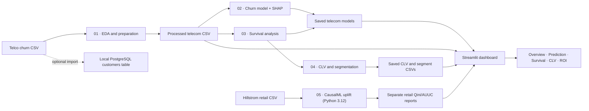

# RetainAI

**Customer retention analytics for churn risk, customer value, and retention
planning.** RetainAI combines an interactive Streamlit dashboard with a set of
reproducible analysis notebooks and saved machine-learning artifacts. Its primary
customer dataset is the IBM Telco Customer Churn sample; a separate Hillstrom
retail email experiment demonstrates uplift modeling without transferring retail
effects to telecom customers.

> **Scope:** RetainAI is a learning and decision-support project, not a production
> retention policy. Its estimated effects and values are not causal guarantees.
> In particular, Hillstrom retail email uplift estimates must **not** be applied
> directly to telecom customers.

## Project overview and objectives

The project explores an end-to-end retention analytics workflow:

1. Inspect and prepare telecom customer data.
2. Predict customer churn risk and explain individual predictions.
3. Model customer survival and estimate a limited-horizon customer lifetime value
   (CLV).
4. Segment the historically active customer cohort.
5. Simulate retention campaign economics using explicit, adjustable assumptions.
6. Separately evaluate treatment-effect ranking on a randomized retail email
   experiment.

The Streamlit dashboard reads the committed/prepared CSVs and saved telecom model
artifacts; PostgreSQL is an optional data-loading exercise and is not required to
run the dashboard.

## Features

- **Customer overview:** cohort KPIs, observed churn charts, model risk
  distribution, and customer filters.
- **Individual churn prediction:** saved LightGBM churn score and customer-level
  TreeSHAP explanations.
- **Survival analysis:** cohort Kaplan–Meier curves and conditional Cox survival
  curves. Estimates are limited to the training data's observed horizon.
- **CLV and segmentation:** saved CLV estimates and four K-means customer
  segments.
- **Retention ROI simulator:** editable budget, monthly discount and duration,
  assumed retention uplift, outreach cost, and minimum risk threshold. This is a
  scenario calculator—not an estimated causal treatment effect.
- **Separate Hillstrom results:** saved retail Qini/AUUC scores and curves, shown
  only as retail experiment results.

## Technology stack

| Area | Technologies |
|---|---|
| Dashboard | Python 3.14, Streamlit, Plotly |
| Churn model and explanations | LightGBM, scikit-learn, SHAP |
| Survival and CLV | lifelines (Kaplan–Meier and Cox proportional hazards) |
| Segmentation | scikit-learn K-means and feature scaling |
| Uplift notebook | Python 3.12, CausalML `BaseTClassifier`, LightGBM |
| Data and serialization | pandas, NumPy, joblib, CSV, Jupyter |
| Optional database loader | PostgreSQL, SQLAlchemy, psycopg2 |
| Tests | Python `unittest`, Streamlit `AppTest` |

Dependency versions are recorded separately in [`requirements.txt`](requirements.txt)
for the Python 3.14 dashboard/notebook environment and
[`requirements-uplift-py312.txt`](requirements-uplift-py312.txt) for the Python 3.12
uplift environment.

## Dataset sources and local data

Dataset files and row-level model artifacts are intentionally excluded from
version control because redistribution terms have not been established. To run
the application or notebooks, acquire each dataset directly from its provider
under applicable terms and place it at the expected local path:

| Expected local path | Contents | Source |
|---|---|---|
| `data/raw/telco_churn.csv` | Telco customer attributes and observed churn label (7,043 rows) | IBM Telco sample hosted at the [Kaggle dataset download page](https://www.kaggle.com/datasets/blastchar/telco-customer-churn) |
| `data/raw/hillstrom.csv` | Randomized retail email experiment (64,000 rows) | Kevin Hillstrom's [MineThatData challenge post and CSV download](https://blog.minethatdata.com/2008/03/minethatdata-e-mail-analytics-and-data.html) |
| `data/processed/cleaned_telco.csv` | Prepared telecom features and churn outcome | Generated by notebook 01 |
| `data/processed/customer_clv.csv` | CLV estimates for historically active customers | Generated by notebook 04 |
| `data/processed/customer_segments.csv` | CLV cohort with segment assignments | Generated by notebook 04 |

### Get the input datasets

1. Review each provider's terms and confirm you are permitted to download and
   use the dataset for your purpose.
2. From the Kaggle Telco dataset page, download and extract
   `WA_Fn-UseC_-Telco-Customer-Churn.csv`. Place it in `data/raw/` as
   `telco_churn.csv`.
3. From the MineThatData challenge post, download the linked CSV and save it
   as `data/raw/hillstrom.csv`.
4. Keep these local input files untracked. Do not upload them or derived
   row-level records unless you have explicit permission.

The processed CSVs, saved model pickle files, and all dataset-derived report
files are also excluded. Run the notebooks with properly licensed data to
regenerate them. A fresh clone alone is **not** a runnable dashboard: it needs
the two locally downloaded input datasets and generated artifacts described
below.

The cited Kaggle Telco mirror attributes copyright to its original authors and
does not identify an open data license. The MineThatData post encourages
participants to share findings, but does not state an explicit dataset or
report license. Therefore no redistribution permission is assumed for either
dataset, derived row-level records, model artifacts, or dataset-derived
figures/reports. The SHAP feature-importance plot and Hillstrom uplift
evaluation plot/metrics are generated locally and ignored by Git pending
permission review. Obtain permission or confirm the applicable terms before
publishing those outputs.

The only checked-in report is the project test log, which contains no customer
records:

- [`reports/test_results.md`](reports/test_results.md)

## Architecture



The optional PostgreSQL path is independent of dashboard execution. Retail
uplift evaluation is displayed as a separate benchmark and is not a telecom
model input.

## Repository structure

```text
RetainAI/
├── .gitignore
├── .streamlit/
│   └── config.toml
├── README.md
├── app.py
├── requirements.txt
├── requirements-uplift-py312.txt
├── data/
│   ├── raw/                      # Local, ignored; download the two input CSVs
│   └── processed/                # Local, ignored; generated by notebooks
├── models/                       # Local, ignored; generated model artifacts
├── notebooks/
│   ├── 01_eda.ipynb
│   ├── 02_churn_model.ipynb
│   ├── 03_survival_analysis.ipynb
│   ├── 04_clv_segmentation.ipynb
│   └── 05_uplift_model.ipynb
├── reports/
│   └── test_results.md
├── src/
│   └── database.py
└── tests/
    └── test_dashboard.py
```

Local environments (`venv/` and `uplift_env/`), credentials, caches, datasets,
processed data, saved model pickle files, and dataset-derived plots/metrics are
excluded by [`.gitignore`](.gitignore). These local files are not deleted;
obtain data under the providers' terms and regenerate artifacts locally. Only
load pickle files from trusted sources.

## Setup and run the dashboard (Python 3.14)

From the project root in PowerShell:

```powershell
py -3.14 -m venv venv
.\venv\Scripts\python.exe -m pip install --upgrade pip
.\venv\Scripts\python.exe -m pip install -r requirements.txt
.\venv\Scripts\python.exe -m streamlit run app.py
```

Before launching, download the input datasets as described above and regenerate
the outputs using the ordered workflow below. The dashboard requires processed
telecom CSVs, churn/survival/segmentation model pickles, and the locally
generated uplift metrics CSV. Open the local URL printed by Streamlit. The
dashboard does not require PostgreSQL or the uplift model pickle.

## Database setup (optional)

[`src/database.py`](src/database.py) imports the raw telecom CSV into a local
PostgreSQL database named `retainai`, using a `customers` table. It prompts for
the PostgreSQL password with `getpass`; do not put credentials in the source
code or commit them.

1. Install and start PostgreSQL locally.
2. Create the database, for example from `psql`:

   ```sql
   CREATE DATABASE retainai;
   ```

3. Ensure the local server is reachable at `localhost:5432` and the `postgres`
   user has permission to create tables in `retainai`.
4. From the project root, run:

   ```powershell
   .\venv\Scripts\python.exe src\database.py
   ```

The script loads `data/raw/telco_churn.csv` and uses `if_exists="fail"`; if a
`customers` table already exists, the import fails rather than overwriting it.
The dashboard itself currently reads the processed CSV files directly and does
not connect to PostgreSQL.

## Model training and notebook workflow

From a fresh clone, first make sure the local output directories exist and
download the two raw CSVs to the paths above:

```powershell
New-Item -ItemType Directory -Force data\raw, data\processed, models, reports | Out-Null
```

Run notebooks 01–04 using the Python 3.14 environment, in this order:

1. [`01_eda.ipynb`](notebooks/01_eda.ipynb) explores and prepares the telecom
   CSV, writing `data/processed/cleaned_telco.csv`.
2. [`02_churn_model.ipynb`](notebooks/02_churn_model.ipynb) trains/evaluates
   LightGBM churn prediction and writes `models/churn_model.pkl`,
   `models/feature_columns.pkl`, and a local SHAP figure.
3. [`03_survival_analysis.ipynb`](notebooks/03_survival_analysis.ipynb) fits
   Kaplan–Meier and Cox survival models, writing both model files under
   `models/`.
4. [`04_clv_segmentation.ipynb`](notebooks/04_clv_segmentation.ipynb) estimates
   CLV and K-means segments for historically active customers, writing the
   processed CLV/segment CSVs and K-means/scaler pickles.

For the first four notebooks, use the Python 3.14 environment:

```powershell
.\venv\Scripts\python.exe -m ipykernel install --user --name retainai --display-name "Python 3.14 (RetainAI)"
Set-Location notebooks
..\venv\Scripts\python.exe -m jupyter notebook
```

Select **Python 3.14 (RetainAI)** and run each notebook's populated cells from
top to bottom. Close Jupyter and run `Set-Location ..` to return to the
repository root before following later commands.
The uplift notebook requires its separate Python 3.12 environment:

```powershell
py -3.12 -m venv uplift_env
.\uplift_env\Scripts\python.exe -m pip install --upgrade pip
.\uplift_env\Scripts\python.exe -m pip install -r requirements-uplift-py312.txt
.\uplift_env\Scripts\python.exe -m ipykernel install --user --name uplift_env --display-name "Python 3.12 (RetainAI uplift)"
```

Run `05_uplift_model.ipynb` from VS Code/Jupyter using the **Python 3.12
(RetainAI uplift)** kernel. It saves the uplift bundle, held-out metrics,
row-level predictions, and evaluation plot locally; those generated outputs
remain ignored by Git. Notebook outputs are cleared in the public version to
avoid publishing customer-level rows. The uplift notebook locates the project
root itself, so it does not depend on the notebook working directory. To launch
Jupyter from the project root for notebook 05:

```powershell
.\venv\Scripts\python.exe -m jupyter notebook notebooks
```

Select **Python 3.12 (RetainAI uplift)**, then close Jupyter and return to the
project root before starting the dashboard.

The notebooks write trained models under `models/`; the dashboard uses saved
models and does not retrain them at startup. These generated pickles are ignored
by Git and are Python-version/library-sensitive. Retrain them locally and only
load trusted model files. Once the four telecom notebooks and the uplift
notebook have run, launch the dashboard from the repository root using the
command in the previous section.

## Actual model results (historical local run)

These are values from previous notebook runs, summarized without row-level
records. The associated charts and metrics files are generated locally and not
included in the current repository snapshot pending dataset/report permission
review. Neither dataset provider gives an explicit license for these derived
results; confirm publication permission before publishing this section. The
metrics are historical local results and must be regenerated after downloading
the source datasets to reproduce them.

### Telecom churn classifier

The churn notebook uses an 80/20 stratified train/test split with
`random_state=42` and a LightGBM classifier. The recorded test set has 1,409
customers.

| Metric | Recorded test result |
|---|---:|
| Accuracy | 0.7928 |
| ROC-AUC | 0.8429 |
| Churn-class precision | 0.63 |
| Churn-class recall | 0.52 |
| Churn-class F1 | 0.57 |
| Churn-class support | 374 |

### Telecom survival and CLV

| Metric | Recorded result |
|---|---:|
| Cox test concordance index | 0.7956 |
| Saved Cox baseline follow-up maximum | 72 months |
| CLV cohort | 5,174 active customers |
| CLV margin assumption | 40% |
| CLV expected remaining-month horizon | Up to 12 months |
| Mean saved expected remaining months | 9.38 |
| Mean saved CLV | $216.87 |

CLV is a modeled value estimate from monthly charges, expected remaining
months, and a 40% margin. It is not realized profit or a forecast validated
against future cash flows.

### Hillstrom retail uplift evaluation

The uplift notebook uses a 75/25 stratified train/test split, evaluates each
email arm against the `No E-Mail` control separately, and records normalized
CausalML metrics on held-out retail data:

| Retail comparison | Test rows | Qini | AUUC |
|---|---:|---:|---:|
| Mens E-Mail vs. No E-Mail | 10,654 | 0.0245 | 0.5240 |
| Womens E-Mail vs. No E-Mail | 10,673 | 0.0733 | 0.5744 |

These estimates describe the retail email experiment only. They are not
transferable telecom uplift effects and are not used in the telecom ROI
simulator.

## Tests

The dashboard's automated tests use the standard-library `unittest` runner and
Streamlit `AppTest`:

```powershell
.\venv\Scripts\python.exe -m unittest discover -s .\tests -p "test_*.py" -v
```

The recorded run in [`reports/test_results.md`](reports/test_results.md) passed
**15 tests** with zero failures and zero errors. It covers the five pages and
filters, churn scoring, SHAP additivity, survival probability bounds and
horizon limits, CLV calculations, missing-file handling, sidebar text contrast,
and profitable, break-even, zero-budget, and loss ROI scenarios.

## Limitations

- The churn classifier's recorded churn recall is 0.52 at its saved
  classification threshold; some churners are missed, and threshold selection
  should reflect business costs.
- Churn scores and SHAP explanations describe model behavior, not intervention
  effects or causal reasons.
- The Cox model is based on historical churn/tenure observations and does not
  support extrapolation beyond its observed 72-month horizon. The CLV workflow
  further caps expected remaining months at 12 and uses an assumed 40% margin.
- CLV and segmentation currently cover the 5,174 customers labeled active in
  the historical data; they are not prospective values for all customers.
- The ROI simulator uses a user-supplied uplift assumption and estimated CLV.
  Its output is scenario arithmetic, not measured campaign ROI.
- Hillstrom is a retail email experiment, not a telecom experiment. Its uplift
  model and scores must not be used to target telecom customers.
- The notebooks use separate Python minor versions, and serialized models may
  be sensitive to package/runtime changes. The uplift notebook's current saved
  source has no execution outputs; see the reproduction notes above.
- Upstream dataset licensing and redistribution terms should be confirmed
  before public distribution.

## Future improvements

- Validate churn probability calibration, decision thresholds, and performance
  across time-based holdouts and relevant customer subgroups.
- Run a telecom retention experiment (or define and validate a suitable causal
  identification strategy) before using uplift for targeting.
- Expand survival follow-up and CLV validation with realized future revenue,
  costs, discounting, and updated margin assumptions.
- Add model/data versioning, reproducible training scripts, and automated
  artifact compatibility checks.
- Add optional database configuration via environment variables or a secrets
  manager, plus integration tests against a disposable PostgreSQL instance.
- Confirm upstream data licenses and provide explicit dataset attribution
  before redistribution.
- Add deployment hardening, monitoring, access control, and privacy review
  before using real customer data.
